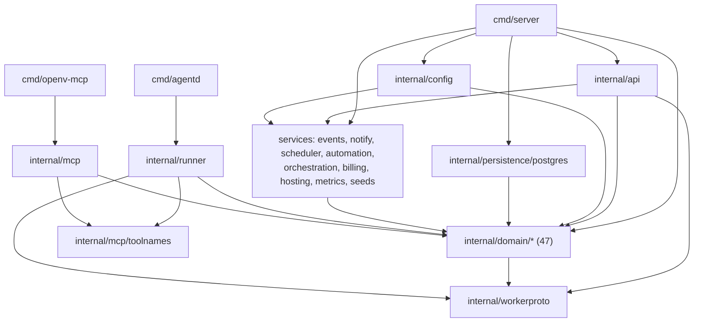

# OpenV Architecture

How the code is laid out today and how a request, a run and a deployment
move through it. The package graph below is the one `go list` and the
architecture tests see (`internal/archtest`, whose `ratchets.json` freezes
every import edge); the areas are those of the area index,
[`areas.json`](areas.json). Where this page and the code disagree, the code
wins: the archtest, the route goldens and the boot goldens are what a pull
request is held to. A test in `internal/archtest` keeps this page naming
every package of the module. How the code is changing, and why, is the
refactor plan, [`plans/codebase-refactor.md`](plans/codebase-refactor.md).

Detail lives in the area guides, the READMEs beside the code, and this page
links to them instead of repeating them:
[`cmd/server`](../cmd/server/README.md),
[`internal/api`](../internal/api/README.md),
[`internal/persistence/postgres`](../internal/persistence/postgres/README.md),
[`internal/domain`](../internal/domain/README.md),
[`internal/runner`](../internal/runner/README.md), which covers
`internal/mcp` too,
[`internal/notify`](../internal/notify/README.md) with the other background
services, [`internal/archtest`](../internal/archtest/README.md),
[`internal/contract`](../internal/contract/README.md),
[`frontend/src`](../frontend/src/README.md),
[`frontend/src/api`](../frontend/src/api/README.md),
[`e2e`](../e2e/README.md) and [`scripts`](../scripts/README.md).

## System at a glance

```
 Browser ── React SPA (frontend/, served by nginx; /api/ proxied to the API)
    │  HTTP, session cookie + X-Org-ID     ▲ SSE: notifications, run logs,
    ▼                                      │ guided chat, interviews
 cmd/server ── one gorilla/mux router, one middleware chain
    │          internal/api: area handler files, authz, respond/httperr
    ▼
 internal/domain/* ── services and their repository interfaces
    ▼
 internal/persistence/postgres ── repositories, numbered migrations
    ▼
 PostgreSQL (pg_trgm, optional pgvector)   UPLOADS_DIR (attachment files)

 Agent work: a run is a row in agent_runs. The server never calls a model
 provider. A runner, cmd/agentd (internal/runner), polls the queue over
 HTTP with a runner key, runs the operator's vendor CLI (Claude Code, Codex,
 Gemini, Antigravity) and hands it cmd/openv-mcp, whose tools (internal/mcp)
 call the API back with the run's token. Runners run on a member's machine
 (the Agent Connector, cmd/openv-connector), in a hosted container the API
 provisions over Docker (internal/hosting), or as a leased node of the
 transient pool.
```

## Programs

| Package | Program | What it is |
|---|---|---|
| `cmd/server` | API server | The HTTP API, background loops and the release announcer, in one process. |
| `cmd/agentd` | runner | Polls for runs and runs the vendor CLIs; also a pool node (`-pool-key`). |
| `cmd/openv-mcp` | MCP server | The tools an agent calls, over stdio; authenticates with a run token or a runner key. |
| `cmd/openv-connector` | Agent Connector | A member's one-file runner: pairs with the app and starts `agentd`. |
| `cmd/openv-vapid` | key tool | Makes a web push VAPID key pair. |
| `.` (`release_notes.go`) | – | Embeds `RELEASE_NOTES.md`, which the server announces. |

Every environment variable these read is in [env-vars.md](env-vars.md).

## Areas

The area index, [`areas.json`](areas.json), gives every tracked file that is
not a test file one of twelve areas, a slice of the product through every
layer, and no file two. It also holds the glossary of the words the UI and
the code use differently (workspace and org, crew and team, runner and
worker). `go run ./internal/tools/areas which <path>` names the area of a
path, or the one a new file would join; `internal/tools/areas` and
`frontend/src/arch/areas.test.ts` keep the index complete and each glob
live. A new file joins an area through a glob in `areas.json`.

| Area | Holds |
|---|---|
| `requirements-core` | projects, artifacts, links and link rules, attributes, quality rules, reference parties, product profile, notes and mentions, the board, search and duplicates |
| `verification` | verification methods, test runs and results, coverage and gaps, the matrix, change impact, evidence bundles |
| `documents` | exports and imports, downloads, PDF, Word and V&V reports, baselines and their comparison, templates, attachments and figures |
| `tenancy-identity` | accounts, sign-in, sessions, verification and resets, workspaces, members, people-teams, invitations, plan limits, project access, `authz.go` |
| `agent-suite` | agents, runs and orchestration, crews, automations, proposals, providers, repository connections, the guided wizard, interviews, the AI map, the MCP server's core |
| `runner-fleet` | the runner and its worker protocol, runner keys, hosted runners, the transient pool, the Agent Connector |
| `events-notifications` | the event bus and domain events, the activity log, the SSE hub, notifications by app, mail and web push, announcements |
| `community` | share links, the open-source showcase, the community pool of demo products |
| `billing` | the billing service, its Stripe client, prices, checkout, seats, reconciliation |
| `platform-http` | the composition root, the router, handler deps, HTTP plumbing, health, the database connection and migration ledger, env parsing, metrics, the release and feature gates |
| `frontend-shell` | `App.tsx`, the API client barrel, state, hooks, the UI kit, navigation, the public site and manual, the test mock, the build and nginx files |
| `tooling` | scripts, CI and release workflows, Dockerfiles, the refactor tools and architecture guards, repository docs |

## Backend packages

`go list . ./cmd/... ./internal/...` names 85 packages: the root package,
the five programs, 47 packages under `internal/domain`, the API, the
persistence layer, the configuration (`internal/config`, `internal/envparse`),
ten service packages, the runner and the MCP packages, the types-only leaf
`internal/workerproto`, 11 refactor tools under `internal/tools`, and three
that hold only tests (`internal/archtest`, `internal/contract`,
`internal/vocabparity`). The 82 with production code import one another through
264 production edges, every one listed in `internal/archtest/ratchets.json`
(`import_edges`), so a new one is a decision made in review. Imports made by
test files are not edges.



The layering (K7), which `internal/archtest` enforces on every pull request:

- a package under `internal/domain` imports only other domain packages and
  the types-only leaves (`typesLeaves`: `internal/workerproto`, whose worker
  wire bodies `agentruns` aliases), so no domain rule depends on the API, the
  database code or the composition root;
- a types-only leaf imports no package of the module;
- `internal/persistence/postgres` imports only the domain;
- `internal/api` never imports the persistence layer;
- the client programs link as little of the domain as they can: `agentd`
  links seven domain packages (`agentruns`, `agents`, `events`, `providers`,
  `repoconns`, `runnersessions`, `tokens`), `openv-mcp` one (`artifacts`),
  and the connector and the VAPID tool none (`client_domain_deps`). The names
  and bodies the clients share with the server live in two leaves,
  `internal/workerproto` and `internal/mcp/toolnames`, so a client does not
  link a domain package to read them.

A domain package declares what it needs as an interface, a port, and
`cmd/server` wires the implementation (as `artifacts` does with
`LinkSuspector`, which `links` implements). There are no layering exceptions
and no domain package imports `reflect`.

| Layer | Packages | Role |
|---|---|---|
| Composition root | `cmd/server` | builds everything, in a fixed order, and serves |
| Configuration | `internal/config`, `internal/envparse` | the settings every stage reads, and the one rule for reading one |
| API | `internal/api` | routes, middleware, authorization, request and response shapes |
| Domain | `internal/domain/*` | entities, rules, `Service` and `Repository` interfaces, mostly a `DefaultService` each |
| Persistence | `internal/persistence/postgres` | one repository per aggregate, the schema and its migrations |
| Services | `internal/events`, `internal/notify`, `internal/scheduler`, `internal/automation`, `internal/orchestration`, `internal/billing`, `internal/hosting`, `internal/metrics`, `internal/seeds` | the work that is not a request |
| Agent execution | `internal/runner`, `internal/mcp`, `internal/workerproto` | the runner's adapters, pool and worker client; the MCP tool table and its API client; the worker wire |

### Package inventory

Every package under `internal/`, once. The domain packages are grouped by
the area that owns them; the area guide of
[`internal/domain`](../internal/domain/README.md) has their files.

**Application and infrastructure**

| Package | Holds |
|---|---|
| `internal/api` | the handlers, the single route table, middleware, authorization guards and the SSE hub |
| `internal/config` | the server's configuration (X10): `Load` records every variable the boot stages read through the lookup it is given, and an accessor per setting parses it as the stage always did |
| `internal/envparse` | the one rule for reading a setting from the environment, with its warnings |
| `internal/persistence/postgres` | the repositories, the frozen baseline schema and the numbered migrations |
| `internal/events` | the in-process event bus: stores each domain event, then calls its subscribers in order |
| `internal/notify` | the notifier, mail, web push, the release announcer, the stable scheduler, the budget and minutes monitors |
| `internal/scheduler` | the cron automations that are due, with catch-up at start |
| `internal/automation` | the trigger matcher: launches the automations whose event filter matches |
| `internal/orchestration` | the run hooks: board moves, crew follow-ups and hand-offs, interview sessions |
| `internal/billing` | the subscription mirror: the entitlement each workspace gets from the provider's view |
| `internal/billing/stripe` | the Stripe client behind `billing.Provider` |
| `internal/hosting` | provisions hosted-runner containers on the local Docker daemon |
| `internal/metrics` | the Prometheus registry and the HTTP middleware that feeds it |
| `internal/seeds` | the default agents of a workspace and the community pool's built-in demo products |
| `internal/runner` | what `agentd` runs: the vendor-CLI adapters, the worker loop and API client, the pool node, CLI sign-in |
| `internal/mcp` | the MCP tool table, built from one constructor per area, and the client that calls the API |
| `internal/mcp/toolnames` | the names an agent's tool allowlist uses for the MCP server; a leaf the runner, `seeds` and `mcp` share |
| `internal/workerproto` | the bodies of the worker wire (claim, start, log, finish, release, sign-in relay, pool); a types-only leaf |

**Domain, by area**

| Area | Package | Holds |
|---|---|---|
| requirements-core | `internal/domain/artifacts` | the artifact, its types and statuses, the catalogue and transitions, versions |
| | `internal/domain/attributes` | typed attribute definitions per workspace and project |
| | `internal/domain/chatter` | the notes thread of an artifact |
| | `internal/domain/embeddings` | vector embeddings of artifact text for nearest-neighbour search |
| | `internal/domain/links` | link types and rules, the link service, suspect marking |
| | `internal/domain/mentions` | resolves `@name` in a note to a project member |
| | `internal/domain/products` | the product profile |
| | `internal/domain/projects` | projects and their settings |
| | `internal/domain/quality` | the rule-based linter over a requirement's wording |
| | `internal/domain/settings` | workspace and project preferences: the quality rule set, reference parties |
| | `internal/domain/traceability` | the link write service the four link-write paths share |
| | `internal/domain/workitems` | the kanban work items |
| verification | `internal/domain/evidence` | evidence bundles |
| | `internal/domain/vv` | verification methods, test runs and results, coverage, gaps, change impact |
| documents | `internal/domain/attachments` | attachments and figures |
| | `internal/domain/baselines` | baselines and their comparison |
| | `internal/domain/downloads` | assembles one project download |
| | `internal/domain/exports` | JSON, CSV, ReqIF and XLSX export, and import |
| | `internal/domain/reports` | the PDF specification, the Word document and the V&V report |
| | `internal/domain/reports/doc` | the document model every report is built from |
| | `internal/domain/snapshot` | the project snapshot (`ProjectExport`) and `Load`, the one way to read it |
| | `internal/domain/templates` | project templates |
| tenancy-identity | `internal/domain/invitations` | workspace invitations |
| | `internal/domain/members` | project membership and the role ladder |
| | `internal/domain/orgs` | workspaces, plans and limits, people-teams |
| | `internal/domain/tokens` | the random tokens the platform mints, and their stored hash |
| | `internal/domain/users` | accounts, sessions, verification and reset |
| | `internal/domain/usermetrics` | the platform admin's user dashboard |
| agent-suite | `internal/domain/agentruns` | runs, the queue, the budget guard and routing |
| | `internal/domain/agents` | agent definitions |
| | `internal/domain/automations` | automation rules |
| | `internal/domain/crewtemplates` | a crew as a portable document |
| | `internal/domain/guided` | guided sessions |
| | `internal/domain/interviews` | interviews and their invites |
| | `internal/domain/proposals` | agent proposals and their review |
| | `internal/domain/providers` | provider settings and sign-ins, the known providers |
| | `internal/domain/repoconns` | repository connections |
| | `internal/domain/teams` | crews (the code says team) |
| runner-fleet | `internal/domain/hostedworkers` | a workspace's hosted runner |
| | `internal/domain/runnersessions` | the transient pool and its leases |
| | `internal/domain/workerkeys` | runner keys |
| events-notifications | `internal/domain/events` | the domain event types |
| | `internal/domain/notifications` | in-app notifications |
| | `internal/domain/pushsubs` | web push subscriptions |
| community | `internal/domain/sharedproducts` | the community pool of demo products |
| | `internal/domain/sharelinks` | share links |
| platform-http | `internal/domain/release` | the release notes the binary carries, the feature registry |

**Refactor tools and guards**

| Package | Holds |
|---|---|
| `internal/tools/areas` | `which <path>`: the area of a file, from `areas.json` |
| `internal/tools/declhash` | hashes every declaration, to prove a pure move |
| `internal/tools/declmove` | performs a pure move from a committed spec |
| `internal/tools/movecheck` | shows where declarations live, and how a move changed that |
| `internal/tools/stageextract` | generates the boot stages of `cmd/server` |
| `internal/tools/splittools` | generates the MCP tool constructors |
| `internal/tools/embeddeps` | rewrites `Handler` to embed `HandlerDeps` |
| `internal/tools/httpio` | the codemod that moved JSON responses and decodes onto the `respond.go` helpers |
| `internal/tools/liftmigrations` | lifts each migration into its own file |
| `internal/tools/envdoc` | writes `docs/env-vars.md` from the env var inventory |
| `internal/tools/scaffold` | writes the first files of a common change |
| `internal/archtest` | the architecture rules ([below](#architecture-rules)); tests only |
| `internal/contract` | the generated Go-to-TypeScript contract ([below](#the-contract-pipeline)); tests only |
| `internal/vocabparity` | the vocabularies the frontend copies, as `contracts/vocab.json`; tests only |

The tools ship nothing; [`internal/tools/README.md`](../internal/tools/README.md)
says which class of refactor each proves or generates.

### Composition root: `cmd/server`

`main()` (`main.go`, about 60 lines) creates one `app` (`app.go`), whose
fields are the values more than one stage shares, and calls the stages in a
fixed order, then serves until a signal and drains for up to 15 seconds.
Each stage is a method in a `wire_*.go` file and wires one concern:

| Stage | File | Wires |
|---|---|---|
| `signals`, `config` | `wire_config.go` | the configuration, the logger and the signal context; the database URL, port and directories, `WORKER_API_KEY`, the plan and limit settings |
| `connect`, `storage` | `wire_storage.go` | the pool (whose close `main` defers); `MigrateAndBackfill` under the boot lock; every repository and the event bus |
| `core` | `wire_core.go` | artifacts, links, embeddings, projects, attachments, baselines, chatter, exports, reports, downloads, templates |
| `workspace`, `runners` | `wire_workspace.go` | users, members, workspaces and the tiers, invitations, runner keys, hosted runners, the transient pool; the legacy key |
| `projects` | `wire_projects.go` | attributes, V&V and evidence, work items, the product profile, project settings, guided sessions, interviews, share links, the community pool |
| `agents` | `wire_agents.go` | agents, runs and their retry policy, automations, repository connections, providers and their sign-ins, crews, proposals and their appliers |
| `realtime` | `wire_realtime.go` | the metrics collector, the SSE hub and the orchestration hooks, subscribed to runs and the bus |
| `notify`, `release` | `wire_notify.go` | mail, sign-up verification, the session and registration policies, notifications, web push, the minutes monitor; the running release, its announcer and the stable scheduler |
| `jobs` | `wire_jobs.go` | the budget guard, trigger matcher, scheduler, workspace purge and reaper loops |
| `sso` | `wire_sso.go` | Google and OIDC sign-in |
| `billing`, `handlers`, `server` | `wire_http.go` | billing; `api.NewHandler` with every dependency, then the proposal service's appliers; the HTTP server |

Beside them: `app.go` holds `env`, the `internal/config` configuration
stage `signals` loads, which every stage reads its settings through;
`http.go` builds the middleware chain (`buildHTTPHandler`) and the server, `jobs.go` the reaper
and purge loops and the boot call of the hosted-runner reconcile (whose rule
is `hostedworkers.Reconcile`), `lookups.go` the closures that join
two domains (a project's workspace and the budget guard, whose rules are
`ProjectRepository.OrgIDForProject` and `agentruns.BudgetGuard`), and
`logging.go` the log setup. `cmd/server/testdata/boot_steps.txt` (S4) pins
the order of every call `main()` makes; new wiring goes in the stage that
owns its concern.

### Configuration: `internal/config`

`signals` calls `config.Load(os.LookupEnv)` once. `Load` reads nothing
itself: it records, for every variable the boot stages read, the raw value
and whether it is set, through the lookup it is handed. An accessor per
setting then parses and validates it on each call with the parser, default
and condition the stage used before X10, so a malformed value warns where it
always did (`internal/envparse` is the rule). Since X10b no boot stage reads
the environment but through `*config.Config`. What stays outside it, by
design: reads that happen per request, `OPENV_MCP_TOOLS` (the MCP server's),
and the runner's and `agentd`'s own settings. [env-vars.md](env-vars.md)
lists every variable; the archtest's direct-env-read ceilings and the S8
inventory ([below](#architecture-rules)) keep new reads from appearing
elsewhere.

### API layer: `internal/api`

- `handlers.go` holds only the dependencies: `HandlerDeps`, `Handler` (which
  embeds it) and `NewHandler`, which builds the rate limiters and reads the
  per-request settings once at boot.
- `routes.go` is `RegisterRoutes`, the ordered list of registrar calls.
  gorilla/mux serves the first route that matches, so that order is the
  contract, pinned by `testdata/route_handlers.txt`; `agent_handlers.go`,
  `org_handlers.go` and `suite_handlers.go` hold only the ordered
  sub-registrar lists of their surfaces.
- 70 area files, `<area>_handlers.go`, each with its `register<Area>Routes`
  and its handlers, spread over ten of the twelve areas
  (17 files for requirements-core, 14 each for tenancy-identity and
  agent-suite).
  `proposal_appliers.go`, `ai_map.go` and the guided outline sit with
  agent-suite, `authz.go`, `authmiddleware.go`, `cookies.go`, `limits.go`
  and `registration_policy.go` with tenancy-identity.
  `go run ./internal/tools/areas which <file>` names a file's area.
- Shared homes (K3), so a helper is found where its kind lives:
  `respond.go` (JSON in and out: `respondJSON`, the `writeJSON` family,
  `decodeJSON`), `httperr.go` (error writers; internals go to the log, a
  fixed message to the client), `errmap.go` (per-area error tables),
  `authz.go` (every `require*` guard but two), `limits.go` (the plan
  read-only gate, over `orgs.LimitEnforcer`'s counts), `publish.go` (domain
  events), `sse.go` (the SSE hub), and the `middleware_*.go`,
  `compression.go`, `ratelimit.go`, `requestlog.go` and
  `security_headers.go` plumbing.
- The four paths that write traceability links (`POST` and
  `DELETE /links`, the managed link edits of `PUT /artifacts/{id}`, the
  proposal appliers and the guided drafts) call
  `internal/domain/traceability`, each with the `Policy`
  `link_traceability.go` gives it; their `require*` guards stay in the
  handlers.
- The JSON export, the AI map, the baseline diff and the open-source
  showcase read a project's snapshot through `snapshot.Load`, as `reports`
  does; `project_snapshot.go` supplies the two sources the handlers pass it,
  a stored baseline and the live export.

The route inventory, `testdata/routes.txt`, lists every method and path
(342); `docs/api-spec.md` documents them, and an archtest ratchet counts the
ones it does not.

### Domain: `internal/domain/*`

One package per concept, most with an entity, a `Service` interface, a
`DefaultService` and a `Repository` interface that the persistence layer
implements. Packages that grew several concerns split them into narrow
interfaces (`orgs.Service` is `Workspaces`, `Membership`, `BillingStore`,
`ChannelSettings` and `Alerts`). Only 22 domain packages import another
package of the module.
The busiest dependencies inside the domain: `artifacts` (eleven other domain
packages import it), then `snapshot` and `links` (six each) and `tokens`
(six, the leaf of the identity and invite packages). `snapshot` holds the
project snapshot that reports, baselines, templates, downloads, quality and
V&V read, and `Load`, the one function that reads it, from a baseline or the
live project; `exports` writes and reads the file formats around it.
`traceability` is the link write service: the checks, writes,
`links_snapshot` refreshes, link events and change summaries that the API's
four link-write paths share, each path under a `Policy` of its own, which
keeps where they differ explicit (quirks Q3 and Q4).

### Persistence: `internal/persistence/postgres`

A repository file per aggregate (`<thing>_repository.go`, the workspace's
split by concern), `db.go` and the frozen `schema_*.go` baseline, and the
migration ledger: `migrations.go` registers every numbered migration in
order, and each lives in its own `migration_NNNN_<name>.go`. The `app`'s
`storage` stage runs `MigrateAndBackfill` before anything reads the
database. [data-model.md](data-model.md) describes the tables; the S3
goldens under `testdata/` (`schema/`, `freeze/`, `purge/`) are the exact
schema, ledger and purge catalogue, checked against a real server.

#### The persistence kit (X13)

`pgkit.go` and `nulls.go` hold what every repository's reads, writes and
transactions share. A repository adopts them one at a time.

- **Columns const and scan function.** An entity has one `xColumns` const,
  its SQL column list in the order its scan function reads it
  (`artifactColumns`, `linkColumns`), and one `scanX(row rowScanner)`. Every
  `SELECT` of the entity, and the matching `INSERT`'s column list, is
  assembled from the const, so a field is added in one place. `rowScanner` is
  the interface both `*sql.Row` and `*sql.Rows` satisfy
  (`Scan(dest ...interface{})`), so one scan function serves `QueryRow` and a
  loop over `Query`. A column that may be `NULL` is read through the const's
  own `COALESCE` or a nullable holder in the scan function, as the statement
  it replaced did. An assembled statement equals the literal it replaced,
  byte for byte: the `*_repository_sql_test.go` files hold each to that with
  a recording `database/sql` driver (`sqlRecorder` in `pgkit_test.go`, no
  server), and the `*_repository_columns_test.go` files pin the column reads
  and writes against a real database. Which of `nil` and `[]` an empty list
  returns, and what a missing row answers, stay per method (Q2).
- **The qualifying rule.** A repository gets a columns const and scan
  function when it reads one entity's column list in more than one place.
  One that has a single read, only aggregates, or lists that differ read to
  read does not, and the baseline, event, notification, project-info,
  release, settings and user-metrics repositories do not (32 of the 39
  repository files have a const).
- **Qualifying a list by alias.** `prefixColumns(columns, alias)` prefixes
  each column of a const for a join: it splits on `", "`, so `"id, title"`
  under `a` is `"a.id, a.title"`, and it accepts only a list of bare column
  names. A const holding an expression with a comma inside it
  (`COALESCE(release_channel, '')`) would be cut in the middle, so
  `orgColumns` keeps a hand-written `orgColumnsQualified` beside it. A
  qualified list is built where the join is written
  (`prefixColumns(linkColumns, "l")`), not kept as a second const;
  `attachment_repository.go`'s `prefixedFigureColumns` is the one older
  helper still to fold in.
- **`withTx(ctx, db, opts, fn)`.** Begins a transaction, runs `fn`, commits
  when it returns nil, rolls back on an error or a panic, and answers the
  begin's, `fn`'s or the commit's error as it came. It adds no timeout: a
  caller bounds the transaction through `ctx`, and `db.Begin()` is
  `withTx(context.Background(), db, nil, ...)`. The artifact and V&V
  repositories use it; the other repositories' hand-rolled `db.Begin()`
  sites moved only where `withTx` is exactly equivalent, and those that wrap
  the begin or commit error or return success without committing keep their
  own shape. The migration runner keeps its own transactions.
- **`nulls.go`.** `nullString`, `nullInt`, `nullableString` and `nullUUID`
  turn an empty Go value into a driver `NULL` for a statement's argument.

`scanOrg` and `scanAttachment` still take a row type of their own instead of
`rowScanner`.

### Agent execution: `cmd/agentd`, `internal/runner`, `internal/mcp`

`internal/runner` holds one adapter per vendor CLI (`claudecode.go`,
`codexcli.go`, `geminicli.go`, `antigravity.go`) with its detection probe
and sign-in flows, the worker loop and API client, the pool node
(`pool.go`), and `childEnv`, through which every process it starts gets its
environment, less the runner's own credentials. `internal/mcp` is the tool
table (`Tools()` in `tools.go`, built from one constructor per area in the
`tools_<area>.go` files and filtered by `OPENV_MCP_TOOLS`) and the client
that calls the API; `openv-mcp` serves it over stdio, the runner configures it for
each run, and `internal/seeds` reads its tool names for the default agents.
The bodies the runner and the API exchange are `internal/workerproto`; the
tool names the runner, `seeds` and `mcp` agree on are
`internal/mcp/toolnames`. The API's side of the wire is
`worker_protocol_handlers.go` and the runner key, session and status handler
files.

## Architecture rules

`go test ./internal/archtest` runs in well under a second and is part of
every `go test` and of `make check-fast`. It reads the module's syntax only
(nothing is built or type-checked, so it gives the same answer on every
host), and compares what it finds with `internal/archtest/ratchets.json`.
Every number and list in that file is a **ratchet**: a ceiling that may only
fall or an allowlist that may only shrink. A pull request may lower or
remove an entry; a refactor never raises or adds one, and a refactor pull
request must commit the tightened file
(`UPDATE_RATCHETS=1 go test ./internal/archtest`, which only lowers or
removes entries and refuses to write while a rule fails). Outside a refactor,
adding an entry is an architecture decision made in review. Each failure
names the rule, the allowlist, the regenerate command and the README section
(the first column below links each rule's section of
[`internal/archtest/README.md`](../internal/archtest/README.md)).

| Rule | Enforces | Ratchet in `ratchets.json` |
|---|---|---|
| [Import edges](../internal/archtest/README.md#import-edges) | every production import between the module's packages is listed | `import_edges`: 264 edges |
| [K7 layering](../internal/archtest/README.md#k7-layering) | the layering above | `layering_exceptions`: empty |
| [Client binaries](../internal/archtest/README.md#client-binaries) | the domain packages each client program links may only shrink; a new program needs an entry | `client_domain_deps` |
| [Domain reflection](../internal/archtest/README.md#domain-reflection) | no domain package imports `reflect` | `domain_reflect`: empty |
| [K14 file size](../internal/archtest/README.md#k14-file-size) | a production file has at most 800 lines | `file_lines`: 4 grandfathered files (`reqif.go` and three `reports` files) |
| [K14 function size](../internal/archtest/README.md#k14-function-size) | a function has at most 100 lines | `func_lines`: 28 grandfathered functions |
| [No init functions](../internal/archtest/README.md#no-init-functions) | no `func init()` (K9) | a ban |
| [Side-effecting package variables](../internal/archtest/README.md#side-effecting-package-variables) | a package-level `var` is initialised by pure calls only | `side_effect_vars`: 5, all pure in fact |
| [One router](../internal/archtest/README.md#one-router) | one `mux.NewRouter()`, in `cmd/server`; no sub-routers, prefixes or custom 404 and 405 handlers | a ban |
| [HandleFunc outside registrars](../internal/archtest/README.md#handlefunc-outside-registrars) | routes are registered in an area's `register<Area>Routes` (K1) | `counts.handle_func_outside_registrars`: 1 (`/metrics`) |
| [Handler literals in tests](../internal/archtest/README.md#handler-literals-in-tests) | tests build handlers with `newTestHandler` (K6) | `counts.handler_literals_in_tests`: 0 |
| [Raw JSON encodes](../internal/archtest/README.md#raw-json-encodes) | `internal/api` writes JSON through `respond.go` (K4) | `counts.raw_json_encodes`: 0 |
| [Invalid request body literals](../internal/archtest/README.md#invalid-request-body-literals) | request bodies decode through `decodeJSON` (K4) | `counts.invalid_request_body_literals`: 1 |
| [require helpers outside authz](../internal/archtest/README.md#require-helpers-outside-authz) | guards live in `authz.go` (K3) | `counts.require_outside_authz`: 2 |
| [K3 helper homes](../internal/archtest/README.md#k3-helper-homes) | an unexported helper in an area handler file is used only there | `helper_homes`: 25 |
| [K5 raw HandlerDeps reads](../internal/archtest/README.md#k5-raw-handlerdeps-reads) | only `handlers.go` reads `FrontendURL`, `SecureCookies` and `CrossSiteCookies` raw | a ban |
| [Direct env reads](../internal/archtest/README.md#direct-env-reads) | `os.Getenv` and kin, per package (K8) | `env_reads`: 18 reads in `internal/api`, `internal/mcp`, `internal/runner` and `internal/domain/reports` |
| [R8 decode errors](../internal/archtest/README.md#r8-decode-errors) | a handler does not write a JSON decode error of a protected wire type to the response | the alias list in `decode_test.go` only grows |
| [Build context](../internal/archtest/README.md#build-context) | every package, embed and `go.mod` a Go image links is inside its Dockerfile's `COPY` list | the `COPY` list |
| [Build by package path](../internal/archtest/README.md#build-by-package-path) | no doc, script or workflow builds a single `.go` file under `cmd/` | a ban |
| [API spec drift](../internal/archtest/README.md#api-spec-drift) | counts the routes of `routes.txt` that `docs/api-spec.md` has no row for | `api_spec_undocumented_routes`: 36 of 342 |
| [Architecture doc](../internal/archtest/README.md#architecture-doc) | this page names every package under `cmd/` and `internal/` | a ban |

Beside those, `TestEnvInventory` (S8, not a rule of `TestArchitecture`)
type-checks the module and freezes every environment variable it reads, the
way it reads it and its default, in `internal/archtest/testdata/env_vars.txt`,
and `env_parse.txt` records what each read column returns for the same
inputs. `internal/tools/envdoc`'s `TestEnvVarsDoc` holds `docs/env-vars.md`
to that inventory. The frontend has the same kind of guard in
`frontend/src/arch/`, and `scripts/refactor/refactor_guard.py` (the Refactor
guard job) is what holds a refactor pull request to all of them; it is
described in [`scripts/README.md`](../scripts/README.md).

## The contract pipeline

Go owns what the API says. There is no OpenAPI document: the contract is
four things, each generated from Go or checked against it, and the frontend
is held to them by tests and the type checker. A change that moves any of
them is a behavior change; the generated files and goldens are on the
Refactor guard's golden list, so a refactor pull request may not touch them.

1. **Routes.** The router is built from the registrars, in an order that
   decides what a request matches. Four goldens in `internal/api/testdata/`
   record it: `routes.txt` (every method and path, 342), `route_handlers.txt`
   (registration order and the handler each binds), `route_overlaps.txt` and
   `route_guards.txt` (the `require*` guards each handler visibly calls).
   `TestRouteInventoryIsBackwardCompatible` and `TestRouteBinding` write and
   check them (`UPDATE_ROUTES=1 go test ./internal/api -run
   'TestRouteInventory|TestRouteBinding'`). On the frontend,
   `src/arch/clientRoutes.test.ts` requires every `METHOD PATH` an
   `src/api` module sends to be a line of `routes.txt`, and
   `clientSurface.test.ts` pins the client barrel's export surface.
   `docs/api-spec.md` is written by hand, one table row per route; the API
   spec drift ratchet counts the routes it lacks, and the count only falls.
2. **Events.** `contracts/sse-events.json` (the SSE event names, the stream
   each goes on, the headers a stream writes) and
   `internal/api/testdata/event_payload_types.txt` (each domain event's
   payload keys and Go types) are written by `TestSSEContract` and
   `TestEventPayloadTypes` (`UPDATE_GOLDEN=1`). `src/arch/sseListeners.test.ts`
   checks every `EventSource` listener against the first.
3. **Vocabularies.** Two generators read the Go catalogues. `internal/contract`
   writes `frontend/src/generated/contract.ts`, one `as const` list per
   vocabulary and the union type derived from it (`FeatureKey`,
   `DomainEventType`, `SseEventName`, `ApiErrorCode`, `LinkType`,
   `ArtifactTypeValue`, `ArtifactStatusValue`, `WorkspacePlan`, `VvGapKey`,
   `AgentProvider`), and `internal/contract/testdata/contract.json` with the
   same values. `internal/vocabparity` writes `contracts/vocab.json`, which
   `src/arch/vocabParity.test.ts` compares with every hand-written
   TypeScript copy, tolerating only the differences in
   `contracts/vocab-allowed-diffs.json`. `TestContractAgreesWithS13` holds
   the two outputs equal.
4. **Wire shapes.** `internal/contract` also writes
   `frontend/src/generated/wire.ts`, one `Wire<Name>` interface for each of
   the Go types the API sends most (`Artifact`, `Link`, `Project`, `Org`,
   `User`, `Run`, `Agent`, `Attachment`, `Baseline`, `Notification`, `Event`,
   and `WireBilling`, which `Org` carries), following `encoding/json`'s
   rules, and checks each against a marshalled sample. `src/api/wireCompat.ts`
   is type-only and imported by nothing, so the build erases it, and
   `tsc --noEmit` requires each hand-written response type in `src/api/types/`
   to name only keys its `Wire` twin writes, with types that accept the
   twin's values; its `COMPAT_EXCEPTIONS` lists today's differences with a
   reason.

To regenerate after a deliberate change:

| Changed | Run | Then |
|---|---|---|
| a vocabulary, or a Go type behind `wire.ts` | `UPDATE_CONTRACTS=1 go test ./internal/contract/...` | `cd frontend && npx tsc --noEmit`, which names each copy or hand-written key that no longer fits |
| a vocabulary the frontend copies | `UPDATE_GOLDEN=1 go test ./internal/vocabparity -run '^TestVocabulary$'` | `cd frontend && npx vitest run src/arch/vocabParity.test.ts` |
| routes | `UPDATE_ROUTES=1 go test ./internal/api -run 'TestRouteInventory\|TestRouteBinding'` | a row in `docs/api-spec.md`; `cd frontend && npx vitest run src/arch` |
| an SSE event or a domain event payload | `UPDATE_GOLDEN=1 go test ./internal/api -run '^(TestSSEContract\|TestEventPayloadTypes)$'` | `cd frontend && npx vitest run src/arch/sseListeners.test.ts` |

`make check-fast` runs `go test ./internal/vocabparity ./internal/contract`,
the `TestSSE` and `TestEventPayload` tests of `internal/api`, and the
frontend type check; `make check` and CI's backend and frontend jobs run all
of them, `go test` for the Go side and `tsc`, lint and `vitest` for the
frontend. Only the value `1` regenerates; any other value compares.

## Frontend: `frontend/src`

The React app Vite builds into the frontend image. Everything it imports
lives under `frontend/`; [`frontend/src/README.md`](../frontend/src/README.md)
has the map, invariants and recipes.

- `index.tsx` imports the eager stylesheets in a fixed order; `App.tsx` is
  the hand-written `<Route>` table (K13), each view eager or through
  `lazy()`. `views/` holds the pages, with a split view's parts in
  `views/moduleView/`, `views/projectSettings/` and `views/guidedWizard/`;
  `components/` holds the rest of the UI, the guided wizard's modules in
  `components/wizard/`.
- `generated/contract.ts` and `generated/wire.ts` are the Go-generated
  contract ([above](#the-contract-pipeline)); never edited by hand.
- `state/` holds the zustand store and the active-workspace storage;
  `test/mockApi.ts` is the auto-stubbing mock of the client that view tests
  use (F2): every method of every `*API` object becomes a `vi.fn`, and an
  override naming a method the client lacks throws.
- `arch/` holds the frontend's architecture tests: the area index, the
  client's surface and routes, the route tree and page registry, CSS order
  and size budgets, deep links, SSE listeners, error chains and vocabulary
  parity with Go.

### The API client: `src/api`

`api/client.ts` is a barrel, and code outside `src/api` imports only it and
three small modules (`api/errors`, `api/baseURL`, `api/contentDisposition`;
K12), so a test's `vi.mock('../api/client')` still stubs every call.

| Module | Holds |
|---|---|
| `http.ts` | the one axios instance and its two interceptors (the `X-Org-ID` header out; the sign-in and verify-email redirects back), `uploadConfig`, `downloadBlob` |
| `artifacts.ts`, `projects.ts`, `attachments.ts`, `vv.ts`, `guided.ts`, `agents.ts`, `account.ts`, `orgs.ts`, `billing.ts`, `runners.ts`, `community.ts`, `notifications.ts`, `platform.ts` | one module per area: its `xxxAPI` objects, helpers and constants |
| `types/<area>.ts` | that area's request and response types, which the build erases |
| `errors.ts` | reading an error answer: `apiErrorMessage`, `apiErrorCode`, `limitRefusal`, `legacyErrorText` (Q20) |
| `wireCompat.ts` | type-only checks of `types/` against `generated/wire.ts` |

The barrel loads `http.ts` first, then re-exports the area modules and their
types. A new endpoint call goes in its area's module, with the path exactly
as the server registers it; `arch/clientRoutes.test.ts` fails until the route
exists. Details and recipes: [`frontend/src/api/README.md`](../frontend/src/api/README.md).

### The page registry: `src/pages.ts`

`pages.ts` (X17) records every routed page once, in 45 `PAGES` entries (22
beneath `/projects/:projectId`, 23 of the site): its path as `App.tsx`
writes it, whether `App.tsx` loads its view eagerly, lazily or only
redirects, whether it renders without a session, its help topic or the
reason it has none, and for a project page the menu lists, a `nav` (group,
label, `end`, and a `feature` that hides it until that gate is on). It
records what `App.tsx` already does and does not render a route, so the
route table stays hand-written. What it does drive is the project menu:
`navSections` is derived from the entries that carry a `nav`, grouped
`Define`, `Verify`, `Plan` and `Agents` and then a headerless tail, in the
order the entries appear, and `ProjectLayout` draws it. `pagePattern(page)`
gives a page's full route pattern, and `projectPath(projectId, path?)` builds
the URL of a project's page for new code.
`arch/pagesParity.test.ts` holds the registry to `App.tsx` (an entry for every
route and a route for every entry, eager or lazy, each entry's URL matching
its own route), to `utils/publicPaths.ts` and to `components/helpTopics.ts`,
which still repeat a page by hand, and `components/navSections.test.ts` holds
`navSections` to the menu it replaced. `node frontend/scripts/scaffold.mjs
page <name>` writes the stub view, the lazy route and the registry entry.

### Hooks

Shared hooks live in `src/hooks/`:

- `useEventStream` (X15) is the one module allowed to open an `EventSource`
  (ESLint's `EVENT_SOURCE_HOOK`; the list of other sites is empty). Its
  callers, `RunDetailPanel`, `GuidedChatPanel`, `InterviewChat` and
  `NotificationBell`, each pass their reconnect policy as named parameters,
  and the keys of the listeners they pass are typed `SseEventName`, so
  `arch/sseListeners.test.ts` can read them.
- `useApiResource` (X15) loads what a view shows: fetch on mount and
  when the active workspace or a dependency changes, a cancelled flag, no
  cache. It is built and tested; no view uses it yet.
- `useFeature` reads the feature gates (its key is typed `FeatureKey`), with
  `useViewport`, `useVisualViewport`, `useSwipe`, `useUploadLimit` and the
  reading-key helpers beside it.

The two heaviest views have been split into hooks, helpers and step functions
beside a shell that still holds the rest of their render code:

- **ModuleView**, `views/moduleView/` (X16). `useModuleData` loads the
  project's artifacts, links, cross-project link ends, parent project,
  quality scores and figures; `useBaselineView` holds the baseline list, the
  switch between live and a baseline, and capture and delete;
  `useColumnResize` the two resizable columns and their remembered widths;
  `useSiblingOrdering` the swap, drag and "Move to" renumbering of siblings
  (keeping its three comparators); `usePanelMode` and `usePanelEscape` a side
  panel's pinned, auto-hidden or hidden mode, its hover and reveal, and
  Escape to dismiss. `DocumentHeader`, `FilterPanel`, `PhoneActionsSheet`,
  `Toolbar` and `TreePane` are props-only panes, and `shared.ts` the types
  they share, so no pane imports the API layer. `ModuleView.tsx` is still
  the shell that composes them, and `arch/sizeBudget.test.ts` holds it to size
  ceilings that only fall.
- **GuidedWizard**, `views/guidedWizard/` (X18). `steps.ts` is the step
  descriptor table: each step's label, whether it can be skipped, how it
  builds its draft artifacts and today's quirks as data (title truncation
  at 120 characters for needs and requirements, 100 for NFRs and never for
  personas, hazards and stubs; a hazard's `moderate` severity; no ids key for
  hazards; Skip on steps 6 and 7 never materialising; the nudge before the
  save). `wizardAnswers.ts` is the typed `WizardAnswers` serializer and
  reader, which keeps unknown keys and the key order of the session it is
  built over, since the answers are stored data. `useGuidedSession` holds
  the session being worked on, the newest committed one, the step and the
  furthest step reached, and the calls that start, reopen, save, abandon and
  commit one. Steps 1 to 6 are render functions beside them
  (`renderFramingStep` in `FramingStep.tsx`, then `renderPersonaStep`,
  `renderNeedsStep`, `renderRequirementsStep`, `renderNfrStep` and
  `renderHazardStep`, with `stepStyles.ts`). Each is a plain function that
  returns the step's elements and takes the form state as props, not a
  component and with no hooks: the wizard calls it where the block stood, so
  React reconciles the same tree and keeps the DOM as it was. The shell,
  `views/GuidedWizard.tsx`, still holds the form state, `renderStepContent`
  (which calls those six and holds step 7, the verification stubs, inline),
  the review step and the assistant mounted in the hidden sheet
  (`components/wizard/`).

## Request path

```
SecurityHeaders → BodyLimit → CORS → Compression → RequestLog → metrics
  → Auth → router → handler
```

`buildHTTPHandler` (`cmd/server/http.go`) builds that chain, outermost
first, and `http_test.go` pins it. `AuthMiddleware` resolves the caller (a
session, a run token, a runner key or the pool key) and the active
workspace before the router sees the request, so an unknown protected path
answers 401. A handler then decodes the body, asks its guard in `authz.go`
(`requireProjectRole`, `requireOrgRole` and the rest; a write also takes the
plan gate, `requireWritable`), calls a domain service, and answers through
`respond.go` or `httperr.go`. The service validates, writes through its
repository, and the handler publishes a domain event (`publish.go`): the
bus persists it and hands it to its subscribers, the notifier, the budget
monitor, the automation trigger matcher and the orchestration hooks.

Errors: a repository returns the domain's sentinel errors (`ErrNotFound`
and its kin); a handler maps them to a status, and `respondError` and
`respondInternal` log the error and answer a fixed public message, so SQL
text and paths never reach a client.

## State

- **Backend.** No application cache: each request reads the database. Two
  things live in the process: the event bus with the SSE hub
  (`internal/events`, `internal/api/sse.go`) and the rate limiters' token
  buckets (`internal/api/ratelimit.go`). Both assume a single API instance.
- **Frontend.** Server data is fetched per view through the API client; the
  zustand store (`state/store.ts`) holds what crosses views, such as the
  signed-in user and the active workspace, which is also kept in local
  storage for the `X-Org-ID` header.

## Testing

- **Go.** `go test . ./cmd/... ./internal/...`; the Postgres tests run when
  `OPENV_TEST_DATABASE_URL` names a server and skip otherwise. API tests
  build their handler with `newTestHandler(t, opts...)` and the shared fakes
  in `internal/api/testkit_test.go`. Goldens pin what must not change: the
  routes and their guards (`internal/api/testdata/`), the schema and stored
  data (`internal/persistence/postgres/testdata/`), the boot and its order
  (`cmd/server/testdata/boot*`), an end-to-end API tour per area
  (`cmd/server/testdata/tour/`), the env var inventory
  (`internal/archtest/testdata/`) and the generated contract
  (`internal/contract/testdata/`, `contracts/`).
- **Architecture.** `internal/archtest` (import edges, layering, size
  budgets, bans, count ratchets and the doc checks; see its README and
  [Architecture rules](#architecture-rules)) and `frontend/src/arch`.
- **Frontend.** vitest with `test/mockApi.ts`; `tsc`, eslint, the build and
  the bundle check.
- **End to end.** Playwright specs under `e2e/tests/`.

`make check-fast` runs the gates for what a branch changed, `make check`
all of them; `CONTRIBUTING.md` says what a pull request needs.

## Deployment topology

### Development (Docker Compose)
```
Your Machine
├── Frontend (React dev server, port 3000)
├── API (Go, port 8080)
└── PostgreSQL (port 5432)
```

### Production (Docker Compose overlay)
Production runs the same stack with `docker-compose.prod.yml` layered on top
(`make prod-up`): the frontend is a static nginx build, healthchecks and
memory limits are added, secrets come from `.env`, and Postgres stops
publishing its port. Full runbook, backup and restore included, in
[operations.md](operations.md); the hosted service runs on Railway
([railway.md](railway.md)).
```
Host
├── Frontend (nginx static build, host port 80, /api/ proxied to the API)
├── API (Go, port 8080, X-Forwarded-For aware behind a proxy)
├── PostgreSQL (internal only)
└── (optional) agentd worker(s), a transient runner pool, hosted-runner
    containers
```
Put a reverse proxy (Caddy, Traefik, nginx) in front for TLS. Kubernetes and
Helm remain a roadmap item.

---

## Multi-tenancy

Every tenant is an **organization** ("workspace"). Data is scoped to an org via
an `org_id` column on `projects`, `agents`, `agent_teams`, `automations`,
`agent_runs`, `guided_sessions`, `domain_events`, `provider_settings`,
`provider_logins`, and `templates` (`schema_orgs.go`).

- **Organizations** — `company` or `personal` (a personal org is auto-created
  at signup). Carry a `plan`, a `limits` JSONB, and an optional
  `monthly_budget_usd` spend cap (warn-only by default; soft-blocks launches at
  100% when `OPENV_BUDGET_ENFORCE=true`).
- **org_members** — `admin` / `member` roles.
- **org_teams / org_team_members** — people-teams within a workspace (distinct
  from agent "crews").
- **project_members** and **project_team_access** — direct and people-team
  grants of the project role ladder (`owner`/`editor`/`viewer`); a user's
  effective role is the highest of the two.
- **worker_keys** — org-scoped runner credentials (workspace, per-member, or
  bound to a transient runner lease via `session_id`).
- **runner_pool_nodes / runner_sessions** — the transient runner pool and the
  leases members hold over it: one node serves one member at a time, and its
  state is wiped between leases.

A boot-time idempotent backfill (`BackfillOrgs` → `PromoteOrgColumns`) creates
personal orgs and promotes the `org_id` columns to `NOT NULL` on databases that
predate multi-tenancy.

### The one deliberate exception: `shared_products`

The community pool of joke demo products (`internal/domain/sharedproducts`,
rolled by the new-project wizard's testing mode) is global on purpose: every
workspace reads and writes the same rows, so the roll list grows as people
share what their agents invent. It is the only table without a visibility
`org_id` — `created_by_org` is moderation metadata, never a filter, and is
never served to clients.

Because it is the one place where text authored in one tenant reaches
another, the containment lives outside the org scoping:

- **On write** — an invention is published automatically, by the member's
  browser under their own session; agent-run tokens and worker keys are
  refused, so every row is attributable to an account and counts against that
  workspace's daily cap. Nobody reviews an entry first, which is a deliberate
  trade for a pool that grows without chores — the removal path below is what
  answers for it. Each entry is flattened to inert single-line text: no line
  breaks, backticks, angle brackets, links, or `openv-suggestion` markers,
  with per-field length caps, name deduplication, a per-workspace daily cap
  and a global pool ceiling.
- **On read** — a rolled product seeds the guided wizard, whose copilot
  prompt therefore states up front that the profile, wizard state and
  transcript are content and never instructions, and fences the state block
  (`buildGuidedCopilotPrompt`). That prompt runs on the member's own machine
  with their credentials, and its replies become one-click Apply buttons, so
  the framing is the control that keeps a stranger's sentence from reading as
  an order.
- **On removal** — three distinct reporters hide an entry automatically
  (repeat clicks by one account do nothing), and a platform admin can delete
  it outright.
- **On ranking** — votes (the roller's "top 5 all time" / "top 5 this week"
  filters) are stored per `(product, user)` for the same reason reports are,
  so a count is of people rather than clicks, and are never served back as
  identity. `shared_products.votes` is a denormalised all-time count written
  in the same transaction as the vote row; the weekly figure is counted from
  `shared_product_votes` over a rolling seven-day window, because it changes
  as time passes rather than only as votes arrive. A hidden entry is neither
  listed nor votable.

Anything else that ever needs to be shared across tenants should copy this
shape rather than dropping the `org_id` filter.
---

## Observability

- **Structured logging** — the process installs a `slog` text handler
  (`OPENV_LOG_LEVEL` sets the level). `RequestLogMiddleware` logs one line per
  request, annotated by the auth middleware with the resolved org/user/actor.
- **Metrics** — a Prometheus registry (`internal/metrics`) is exposed at
  `/metrics` (optionally gated by `OPENV_METRICS_TOKEN`, never behind session
  auth). It records HTTP request counts/latency by method + route template +
  status, agent-run lifecycle counters/gauges (subscribing to run events), and
  live SSE connection counts. Cardinality is deliberately bounded — no
  per-project/user/agent labels.
- **Error responses** are sanitized (`httperr.go`): internals reach the log,
  not the client.
---

## Schema migration ledger

At startup the composition root's `storage` stage
(`cmd/server/wire_storage.go`) calls `postgres.MigrateAndBackfill`
(`migrations.go`), which advances the database through a numbered migration
ledger (`schema_migrations` table) under a boot advisory lock. Migration
0001, the frozen "baseline", wraps the legacy idempotent init chain and
re-runs on every boot; every schema change since is an append-only numbered
migration (0002 on), in a file of its own (`migration_NNNN_<name>.go`),
applied exactly once inside its own transaction (DDL and ledger row commit
together). New schema changes are **never** added to `InitSchema` or the
`schema_*.go` files: a new migration file, appended to the registry in
`migrations.go`.

---

## Security Considerations

Authentication and authorization are enforced on every request; the details
below are generated from `internal/api/authmiddleware.go` and
`internal/api/authz.go`. See `docs/api-spec.md` for the per-route matrix.

### Authentication (`authmiddleware.go`)
Every API request authenticates as one of four principals; only `/health`,
`/metrics`, `/api/v1/auth/*`, and `/api/v1/public/*` are open:

- **Human users** — an `openv_session` HttpOnly cookie (SameSite=Lax, `Secure`
  when `SECURE_COOKIES=true`). Sign-in is email/password by default, with
  optional **Google OIDC** when `GOOGLE_CLIENT_ID`/`GOOGLE_CLIENT_SECRET` are
  set. The first user ever registered becomes the platform admin. Where the
  server can send mail, a password account must confirm an emailed link
  before the middleware serves it anything beyond the auth routes
  (`403 email_unverified`); SSO accounts are verified by their provider.
- **Active workspace (`X-Org-ID`)** — each session request runs in one
  organization ("workspace"). The header selects it; the middleware validates
  membership and falls back to the session's stored active org, then the
  user's personal org. An invalid header degrades to the fallback rather than
  failing the request.
- **Agent runs** — a single-run Bearer token (stored hashed), minted per run,
  scoping a worker's callbacks to that run and its own project.
- **Workers** — org-scoped Bearer worker keys (`worker_keys`, stored hashed):
  workspace keys minted by org admins, per-member personal runner keys, or
  short-lived session keys bound to a transient runner lease. Pool nodes
  present the deployment's `RUNNER_POOL_KEY` instead, which carries no
  workspace identity at all and reaches only the pool endpoints. The
  legacy `WORKER_API_KEY` env value is registered as the bootstrap org's
  workspace key `env-bootstrap` at startup, and accepted directly only while
  no key row holds it: revoked, that row refuses the value, however long the
  environment keeps it, and a restart does not restore it.

### Authorization (`authz.go`)
- **Platform admin** (`users.is_admin`, the first user) passes every check,
  in a project or workspace that exists (one no row has is `404`).
- **Org roles** — `admin` and `member` (`org_members`). Org admins act as
  owners of every project in their org.
- **Project roles** — `owner` > `editor` > `viewer`. A member's effective role
  is the highest of their direct grant (`project_members`) and any people-team
  grant (`org_teams` via `project_team_access`).
- Agent runs count as editor within their own project, except that they never
  approve or reject a proposal, and create no project; workers pass for any
  project in their org, a workspace key as an editor, a personal key only
  where its holder would, reads included. A personal runner claims its
  holder's runs and the ownerless ones its holder could see, and reads a
  claimed run's repository connections with the run's token.

### Transport & hardening
- **CORS** is restricted to the configured frontend origin (`CORS_ORIGIN`),
  with credentials. The API refuses to start when the value is a wildcard or
  empty (`api.CORSMiddleware`): reflecting any origin together with
  credentials would let any site drive the API with a member's cookie.
- **Browser hardening headers** on every API response
  (`internal/api/security_headers.go`): `X-Content-Type-Options: nosniff`,
  `X-Frame-Options: DENY`, a referrer policy and a `default-src 'none'`
  content security policy, plus HSTS when `SECURE_COOKIES` or
  `CROSS_SITE_COOKIES` declares a TLS-only deployment. The frontend's nginx
  serves its own set from `frontend/security-headers.conf`, included in every
  location block (nginx drops inherited `add_header` directives wherever a
  location adds its own), with a CSP that allows scripts from the app's
  origin only and, by default, its own origin as the sole connect source:
  nginx proxies `/api/` to the API (`API_UPSTREAM`), so the browser sees one
  origin and the session cookie is a first-party `SameSite=Lax` cookie. That
  is what makes sign-in work on Safari and iOS, which refuse third-party
  cookies; the split topology (`REACT_APP_API_URL` + `CROSS_SITE_COOKIES`,
  cookies `SameSite=None; Partitioned`) remains supported for other clients.
- **Rate limiting** (`internal/api/ratelimit.go`), in-memory token buckets:
  the public (token-only) interview endpoints per invite and per IP, so a
  leaked invite token cannot become unbounded provider spend; and the
  credential endpoints — every sign-in attempt per client address, failed
  sign-ins per account, registrations per address, and SSO starts and
  callbacks per address (`OPENV_AUTH_*`, `OPENV_REGISTER_*`, `OPENV_SSO_*`;
  every bucket and its default is in [env-vars.md](env-vars.md)).
  Behind a proxy, set `OPENV_CLIENT_IP_HEADER` (e.g. `CF-Connecting-IP`) or
  `OPENV_TRUSTED_PROXY_HOPS=<n>` so limits key on the real client IP; the hop
  count reads `X-Forwarded-For` from the right, so a client-prepended entry
  cannot choose its own bucket. `OPENV_TRUST_PROXY=1` remains a one-hop alias.
- **Request and upload caps**: every JSON body is capped at
  `OPENV_MAX_BODY_MB` (32 MB). A **file upload is exempt from that cap and
  bounded by its own handler** — nesting one `MaxBytesReader` inside another
  enforces the tighter of the two, so the API-wide number would otherwise
  override whatever an upload asked for. A figure is capped by the
  **workspace limit `max_upload_mb`** (free 128 MB, Business Lite 512 MB,
  Business 1 GB, self-hosted and enterprise unrestricted), which
  `OPENV_MAX_UPLOAD_MB` still overrides where an operator sets it; the bytes
  are streamed to disk rather than buffered, and only the leading 512 bytes
  are read for the format check. An upload's
  bytes must sniff as the image type the uploader declared
  (`internal/api/attachment_safety.go`), and an SVG — a document that can
  carry script — is always served as a download inside a sandboxing CSP
  rather than rendered inline on the API origin.
- **Provider key variables** come from a fixed catalog
  (`providers.AllowedAPIKeyEnvs`): a workspace setting can only name the
  variables the vendors' own tools read, so a runner can never be made to
  hand an unrelated host secret to an agent.
- **Log redaction**: the request log replaces the invite-token segment of
  public interview paths with `[token]`.
- **Sanitized error responses** (`internal/api/httperr.go`): clients get a
  stable public message while SQL text, file paths, and upstream details go
  only to the server log.
- **TLS in transit** is terminated by a reverse proxy in front of the stack
  (see operations.md); the compose overlay itself serves plain HTTP.

### Roadmap
- Encryption at rest
- Audit-log export and retention policy
- SSO/SAML beyond Google OIDC
- Multi-region / multi-instance isolation (today's deployment assumes a single
  API instance for the in-process event bus and rate limiter)
---

## Multi-agent suite

OpenV's agent suite turns the platform into a queue-and-review system for
AI-assisted requirements work. The moving parts:

### Event bus
A lightweight in-process bus (`internal/events`) persists domain events
(artifact changes, test results, work-item moves, chatter) and fans them out to
its subscribers: the notifier (`internal/notify`, which stores a notification
and pushes it to the recipient's SSE stream, mail and devices), the budget
monitor, the orchestration hooks and the automation trigger matcher. Live
run updates reach the SSE hub through the run service's own subscribers.

### agent_runs as a queue + host worker topology
Agent work is expressed as rows in `agent_runs` (status, priority, prompt,
heartbeat). The server never executes model calls itself. A host-side worker
(`cmd/agentd`) polls the queue over HTTP, launches the operator's vendor CLI
(claude/codex/gemini) for each run, and heartbeats progress back; a reaper
ends runs whose heartbeat goes stale (failed, or cancelled when their cancel
was requested). This keeps subscriptions and credentials
on the operator's machine.

### MCP tool surface
`cmd/openv-mcp` is an MCP server the vendor CLI attaches to. It exposes typed
tools for reading projects/artifacts/links, drafting artifacts, creating links,
recording test results, and recording candidate needs during interviews. Run
prompts carry identifiers only (lean-context rule); the agent pulls content
through these tools at run time, so authorization is enforced per call.

### Proposal review
Agents with `write_mode: proposal` (the default) never write directly. Each
intended write becomes a proposal row; approved proposals are applied through
the real domain services via the appliers
(`internal/api/proposal_appliers.go`), which the composition root's
`agents` stage builds from those services (`cmd/server/wire_agents.go`) and
its `handlers` stage hands the proposal service after `api.NewHandler`
(`cmd/server/wire_http.go`), so validation and eventing behave exactly as
for human edits, and the appliers need no handler.

### Crews (agent org charts)
Agents can be arranged in **crews** — org charts with a typed edge set
(`delegates-to`, `hands-off-to`, `reviews`; the DB tables keep the historical
`agent_team*` prefix, and `/api/v1/teams*` routes remain as deprecated
aliases). Orchestration hooks route follow-up runs along the graph (a lead
delegates to members), enabling multi-step flows like draft-then-review. Crews
are either project-pinned or workspace-wide.

### Automations
Unattended launch rules (`automations`) fire a run of an agent or crew. Three
kinds: `manual` (run-now), `scheduled` (cron, with catch-up), and `triggered`
(matched against the persisted `domain_events` stream, with per-rule cooldown
and hourly caps). Kanban cards can also enqueue runs by moving into an agent
column.

### Interviews
Stakeholder elicitation via shareable links. An interview has
token-authenticated invites; each participant chats with an interviewer agent
over public (token-only) endpoints, and the agent records candidate needs
through the MCP tools. These public endpoints are the ones the rate limiter
guards.

### Guided wizard + copilot
A guided requirements session (`guided_sessions`) walks a user through product
definition step by step, materializing draft artifacts that become real on
commit. A copilot chat runs alongside it: each message launches a short agent
run (linked via `agent_runs.guided_session_id`) whose reply streams back over
SSE.

### Auth model
Runs, workers, and users are resolved by a single auth middleware; see
[Security Considerations](#security-considerations) above for the full model
(session cookies + optional Google OIDC, org/project RBAC, org-scoped worker
keys, per-run tokens, and public interview invite tokens).
